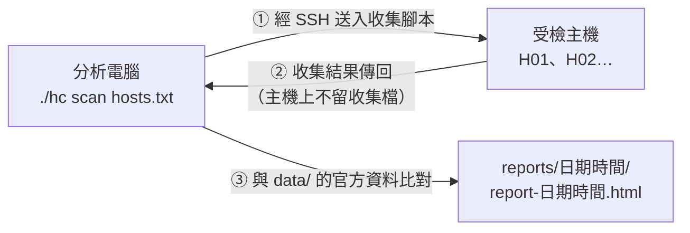
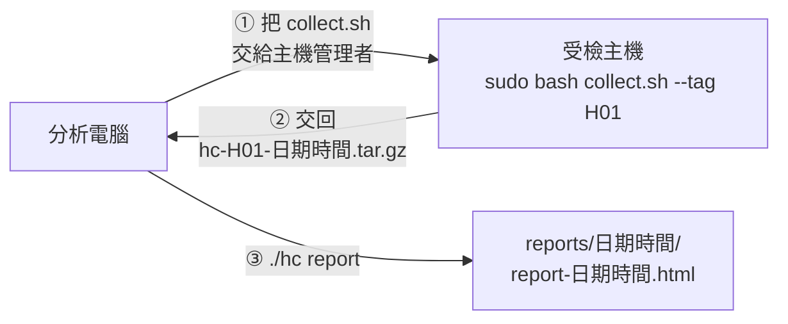

# Ubuntu-Server-Audit

離線環境也能用的 Ubuntu 主機資安健檢工具。

它會告訴你三件事：主機的版本還有沒有官方維護、還有哪些安全更新沒裝，以及哪些更新要訂閱 Ubuntu Pro 才拿得到。比對用的是 Canonical（Ubuntu 的原廠）官方公布的弱點資料，受檢主機上不必安裝任何東西。

**一步一步的操作教學與報告解讀，請看[使用者手冊（PDF）](docs/user-guide.pdf)。**

[English README](README.en.md)

> 本專案不是 Canonical 的官方工具，與 Canonical 沒有隸屬關係，也沒有經過 Canonical 背書。Ubuntu 是 Canonical Ltd. 的商標。

---

## 整個流程

1. **下載工具**到一台「分析電腦」。
2. **掃描主機**：用一個指令收集主機上的套件清單與設定，和官方弱點資料比對。
3. **看報告**：用瀏覽器打開產生的報告，知道哪些更新還沒裝、該先做什麼。
4. **（選用）交給顧問**：把去識別化的結果檔交給健檢顧問，填一份主機用途問卷。
5. **收到主管報告**：顧問依主機的用途排出處理順序與建議期限，回覆一份給主管看的報告。

第 1～3 步都在你自己的電腦上完成；下載完之後，掃描和看報告都不需要上網（官方資料會跟著工具一起下載）。第 4、5 步是選用的顧問服務。

## 開始前

- **分析電腦**：Ubuntu 或 macOS（Windows 未實測），要有 Python 3.6 以上（Ubuntu、macOS 通常已經內建），不必另外安裝套件。
- **指令打在「終端機」裡**：Ubuntu 按 Ctrl＋Alt＋T；macOS 在「應用程式／工具程式」裡找「終端機」。
- **每個指令都要先進到工具的資料夾**（下面的 `cd Ubuntu-Server-Audit`），再執行 `./hc …`。
- 不確定指令怎麼用時，執行 `./hc -h` 看說明，`./hc --version` 看版本。

幾個常見的詞：

| 詞 | 意思 |
|---|---|
| SSH | 從一台電腦遠端登入另一台主機的方式 |
| sudo | 用系統管理員權限執行指令，會詢問你自己的密碼（打密碼時畫面不會顯示字，是正常的） |
| git clone | 從 GitHub 把整個工具下載到電腦上 |
| LTS | Ubuntu 的長期支援版本（例：20.04、22.04、24.04） |
| 官方弱點資料（OVAL） | Canonical 公布的「哪個套件版本有安全問題、要更新到哪一版」清單 |
| `.tar.gz` | 壓縮檔，交回分析時不用解開 |

## 快速開始

```bash
git clone https://github.com/ikusupuroaj/Ubuntu-Server-Audit.git
cd Ubuntu-Server-Audit
```

用 `git clone` 下載時，每天更新的官方弱點資料會一起下載，第一次執行時自動放進 `data/`，帶進封閉環境也能直接用。電腦上沒有 git 的話，到 [Releases](https://github.com/ikusupuroaj/Ubuntu-Server-Audit/releases) 下載 `Ubuntu-Server-Audit-full.zip`，解壓縮後進到資料夾（不要用 GitHub 的「Download ZIP」，那樣拿不到資料）。

接著依你的情況選一種：

| 情況 | 指令 |
|---|---|
| 只想檢查這台電腦自己（要是 Ubuntu） | `./hc local` |
| 這台電腦可以 SSH 到要檢查的主機 | 先建好主機清單，再執行 `./hc scan hosts.txt` |
| 只能請主機管理者自己跑，再把結果交給你 | 主機上：`sudo bash collect.sh --tag H01`<br>你的電腦：`./hc report hc-H01-*.tar.gz` |

三種情況預設都用 sudo 收集。用 sudo 才能檢查 SSH 設定、主機防火牆、空密碼帳號三項；不想用 sudo 時，`./hc local`、`./hc scan` 後面加 `--no-sudo`，這三項會列在報告的「未能檢查」。

### 情況一：只想檢查這台電腦自己

要檢查的 Ubuntu 主機就是你正在用的這台，收集和分析都在這台完成，不需要 SSH。在工具資料夾裡執行：

```bash
./hc local
```

會詢問一次你這個帳號的 sudo 密碼。這個方式只能在 Ubuntu 上用：macOS 沒有 Ubuntu 的套件清單，沒有東西可以檢查。

### 情況二：用 SSH 一次掃描多台主機



**前提**：分析電腦要能用 SSH 金鑰免密碼登入每台主機（設定方式見手冊 3.2 節），主機上的帳號最好能免密碼 sudo（請主機管理者設定；設不了也能跑，只是少檢查三項）。

1. 在工具資料夾裡複製主機清單範本，再用文字編輯器打開（例：`nano hosts.txt`，改完按 Ctrl＋O 存檔、Ctrl＋X 離開）：

   ```bash
   cp hosts.example.txt hosts.txt
   nano hosts.txt
   ```

2. 一行一台，格式是「代號　SSH 登入目標　［其他 ssh 參數，可省略］」：

   ```text
   H01   admin@10.0.0.5
   H02   ops@10.0.0.6     -p 2222
   ```

3. 執行：

   ```bash
   ./hc scan hosts.txt
   ```

收集腳本經 SSH 送進主機執行，結果直接傳回這台電腦，主機上不會留下腳本或收集檔。報告上只會出現代號，不會出現 IP。

### 情況三：請主機管理者自己執行，再把結果交給你

適合從你的電腦連不到主機，或單位不開放 SSH 帳號給你的情況。



1. 把工具資料夾裡的 `collect.sh` 交給主機管理者（隨身碟或內部檔案傳輸都可以）。
2. 管理者在主機上執行，會在目前的資料夾產生 `hc-H01-<日期時間>.tar.gz`：

   ```bash
   sudo bash collect.sh --tag H01
   ```

3. 用 sudo 產生的檔案只有系統管理員能讀。先改成自己的，才複製得出來：

   ```bash
   sudo chown $USER hc-H01-*.tar.gz
   ```

4. 把收集檔複製到你的電腦，放進工具資料夾，再分析。多台主機的收集檔可以一次給：

   ```bash
   ./hc report hc-*.tar.gz
   ```

5. 分析完，請管理者刪除主機上的 `collect.sh` 與 `hc-*.tar.gz`。

## 跑完之後

畫面最後幾行的「報告：」那一行是報告的位置，用瀏覽器打開 `report-日期時間.html` 就能看。每次分析在 `reports/日期時間/` 產生：

| 檔案 | 用途 | 要不要交出去 |
|---|---|---|
| `report-日期時間.html` | 報告，用瀏覽器打開 | 自己看；要給主管或維護廠商時，依單位規定 |
| `findings-ai-日期時間.json` | 去識別化的結果（主機代號改成 H01、H02…，不含單位名稱與 IP） | 要請顧問分析時才交 |
| `oval-detail.json` | 完整比對明細 | 自己留存 |
| `collected/` | 從主機收集來的原始資料（含套件清單）。只有 `./hc local`、`./hc scan` 會產生；`./hc report` 用的是你放進工具資料夾的 `hc-*.tar.gz` | 不要交出去 |

報告、`collected/` 和 `hc-*.tar.gz` 收集檔裡都有主機的套件與設定資訊，請依單位的資料分級保管；確定不需要時，可以整個 `reports/日期時間/` 資料夾和收集檔刪掉。

想先看看報告長什麼樣子，可以用三台虛構主機試跑：

```bash
./hc report samples/demo-ap01 samples/demo-db01 samples/demo-web01
```

## 交給顧問分析（選用）

報告本身已經列出要做的事。如果想依每台主機的用途，知道哪些該先做、建議幾天內完成，可以交給健檢顧問。顧問會回覆兩份文件：給主管看的報告（16:9 投影片版面，可存成 PDF），以及給維護廠商的處理追蹤表。

交之前，**先確認單位規定能不能把去識別化的健檢結果交給外部顧問**。

1. 用瀏覽器打開上傳網頁：<https://ikusupuroaj.github.io/Ubuntu-Server-Audit/upload/>
2. 選擇 `findings-ai-日期時間.json`。檔案只在你的瀏覽器裡讀取，按「送出」之前不會傳到任何地方。
3. 依每台主機勾選問卷（用途、誰連得到、重要性等），不需要提供 IP、主機名稱或帳號。
4. 二選一：
   - **送出**：填機關聯絡資料、勾選同意個資告知後送出，畫面會顯示送件編號，請記下來。
   - **不上傳，下載回答檔**：會下載一個 `answers-送件編號.json`，裡面已經包含健檢結果，只要把這一個檔用 Email 寄給顧問（畫面會顯示收件信箱）。

顧問的聯絡方式與回覆時間，請洽提供本工具的單位。

**資料怎麼保存**：用網頁送出時，資料存在顧問的 Google 雲端硬碟；用 Email 寄的，存在顧問的信箱與雲端硬碟。顧問用 Email 寄出報告、並確認你已收到後就算結案，結案後滿 90 天刪除（雲端硬碟的垃圾桶會再保留 30 天後永久清除）。

詳細步驟見使用者手冊第 6 章。

## 官方資料

工具附的官方資料會隨著時間變舊，建議每月更新一次。

| 要做的事 | 指令 |
|---|---|
| 看資料日期 | `./hc update --list` |
| 從 Canonical 官方網站更新（建議） | `./hc update` |
| 連不到官方網站、但能連 GitHub | `git pull`，或 `./hc update --from github` |
| 帶進離線環境後核對檔案 | `./hc update --verify` |
| 每次掃描前先檢查新資料 | `scan`、`report`、`local` 後面加 `--refresh-data`（連不上就用已下載的，不中斷） |

GitHub 上的資料由 GitHub Actions（GitHub 的自動排程）每天從 Canonical 官方網站取得，放在 `data` 分支（只保留最新一份）與 Releases 的 `data-latest`，檔案未經修改。細節見 [docs/offline-data.md](docs/offline-data.md)。

## 其他文件

- [docs/user-guide.pdf](docs/user-guide.pdf)：使用者手冊（網頁版：[docs/user-guide.html](docs/user-guide.html)）
- [docs/offline-data.md](docs/offline-data.md)：離線環境怎麼更新官方資料
- [docs/custom-rules.md](docs/custom-rules.md)：調整分類、建議文字與門檻
- [docs/how-it-works.md](docs/how-it-works.md)：比對原理與可信度
- [docs/testing-lxd.md](docs/testing-lxd.md)：用 LXD 虛擬機一次測試多個版本

## 支援的版本

受檢主機：Ubuntu 14.04、16.04、18.04、20.04、22.04、24.04、26.04 LTS。非 LTS 版本只會提示升級。

## 和 Canonical sec-cvescan 的關係

做法參考了 Canonical 的 [sec-cvescan](https://github.com/canonical/sec-cvescan)：在主機上產出套件清單，拿到別處離線比對。sec-cvescan 已經停止維護，弱點資料也不再更新，所以本工具改用 Canonical 持續更新的官方 OVAL 資料，並以 OpenSCAP（開源的弱點比對工具，沒裝時用內建的比對程式）比對。本工具沒有使用 sec-cvescan 的程式碼。

## 已知限制

- 只比對 Ubuntu 官方套件庫的套件，自行安裝的第三方軟體不在範圍內。
- 舊的系統核心如果還留在主機上，也可能被列入；實際正在使用的核心，看報告「重新開機」那一類（B 類）。
- 重大與高風險公告的「攻擊途徑」取自官方資料附的 CVSS 評分（3.x 與 4.0 混用，分數照官方原值），代表可能被利用的途徑，不是實際驗證過可被利用；官方沒附的寫「官方未提供」。
- 用 `./hc scan` 收集時，主機上不會留下收集腳本與收集檔；由主機管理者自己執行 `collect.sh` 時，用完請刪除。不論哪種做法，Ubuntu Pro 工具（`pro` 指令）都會更新自己的紀錄檔與快取，SSH 登入與 sudo 會寫進系統的登入紀錄（2026-11 實機測試確認）。
- 還沒在實機上確認：14.04 與 16.04 上的 Ubuntu Pro 工具是否支援 `pro api`。

## 授權

程式碼採用 [Apache License 2.0](LICENSE)。

官方 OVAL 資料的著作權屬於 Canonical Ltd.，授權為 [CC BY-SA 4.0](https://creativecommons.org/licenses/by-sa/4.0/)。本專案的 `data` 分支與 Releases 壓縮檔附帶的是官方原始檔，原樣轉存、未經修改，來源與下載時間記在 `SOURCES.json`。`samples/demo-report/` 裡的公告標題、CVE 編號與版本號，摘錄自 2026-11-19 產生的官方 OVAL。
