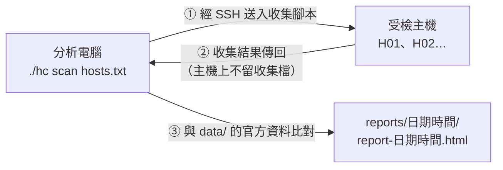
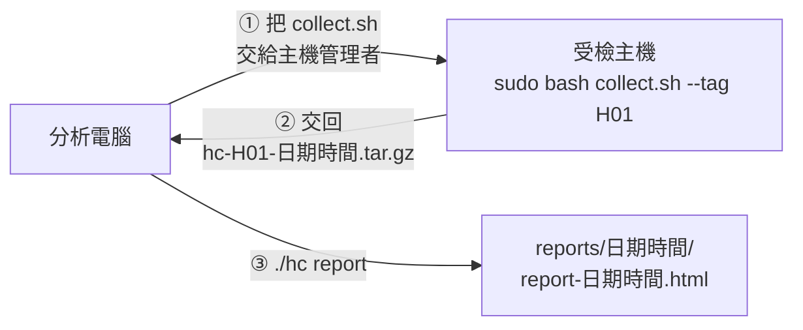

# offline-ubuntu-healthcheck

離線環境也能用的 Ubuntu 主機資安健檢工具。

它會告訴你三件事：主機的版本還有沒有官方維護、缺了哪些安全修補，以及哪些缺口訂閱 Ubuntu Pro 就能補上。比對用的是 **Canonical 官方的 OVAL 弱點資料**，受檢主機上不必安裝任何東西。

**完整的操作教學與報告解讀，請看[使用者手冊（PDF）](docs/user-guide.pdf)。**

[English README](README.en.md)

> 本專案不是 Canonical 的官方工具，與 Canonical 沒有隸屬關係，也沒有經過 Canonical 背書。Ubuntu 是 Canonical Ltd. 的商標。

---

## 快速開始

需要 Python 3.6 以上，不必另外安裝套件。

```bash
git clone https://github.com/ikusupuroaj/Ubuntu-Server-Audit.git
cd Ubuntu-Server-Audit
```

用 `git clone` 下載時，GitHub 上每天更新的官方弱點資料會一起下載，第一次執行時自動放進 `data/`，帶進封閉環境也能直接用。沒有 git 的話，請到 [Releases](https://github.com/ikusupuroaj/Ubuntu-Server-Audit/releases) 下載 `Ubuntu-Server-Audit-full.zip`（不要用 GitHub 的「Download ZIP」，那樣拿不到資料）。

接著依你的情況選一種：

| 情況 | 指令 |
|---|---|
| 只想檢查這台電腦自己（Ubuntu） | `./hc local` |
| 這台電腦可以 SSH 到要檢查的主機 | `cp hosts.example.txt hosts.txt`，編輯後執行 `./hc scan hosts.txt` |
| 只能請主機管理者自己跑，再把結果交給你 | 主機上：`sudo bash collect.sh --tag H01`<br>你的電腦：`./hc report hc-H01-*.tar.gz` |

三種情況預設都用 sudo 收集（0.7.1 起）。用 sudo 才能檢查 SSH 設定、防火牆（ufw）、空密碼帳號三項；不想用 sudo 時，`hc local`、`hc scan` 加 `--no-sudo`，這三項會列在報告的「未能檢查」。

### 情況一：只想檢查這台電腦自己

要檢查的 Ubuntu 主機就是你正在用的這台。收集和分析都在這台完成，不需要 SSH。

```bash
./hc local
```

執行時會詢問你這個帳號的 sudo 密碼。這個方式只能在 Ubuntu 上用：macOS 和 Windows 沒有 Ubuntu 的套件清單，沒有東西可以檢查。

### 情況二：用 SSH 一次掃描多台主機



先複製主機清單範本，再編輯成你要檢查的主機，一行一台，格式是「代號　SSH 登入目標　［其他 ssh 參數，可省略］」：

```bash
cp hosts.example.txt hosts.txt
```

```text
H01   admin@10.0.0.5
H02   ops@10.0.0.6     -p 2222
```

然後執行：

```bash
./hc scan hosts.txt
```

收集腳本經 SSH 送進主機執行，結果直接傳回這台電腦，主機上不會留下腳本或收集檔。報告上只會出現代號，不會出現 IP。預設會用 sudo 收集，主機上的帳號要能免密碼 sudo；沒有設定的主機會自動改用一般權限收集，畫面上會註明。

### 情況三：請主機管理者自己執行，再把結果交給你

適合從你的電腦連不到主機，或單位不開放 SSH 帳號給你的情況。



管理者在主機上執行，會在目前的資料夾產生 `hc-H01-<日期時間>.tar.gz`：

```bash
sudo bash collect.sh --tag H01
```

用 sudo 產生的檔案屬於 root，只有 root 能讀。複製出來之前，先把檔案的擁有者改成自己：

```bash
sudo chown $USER hc-H01-*.tar.gz
```

拿回收集檔後，在你的電腦上分析。多台主機的收集檔可以一次放進去：

```bash
./hc report hc-*.tar.gz
```

分析完，請管理者刪除主機上的 `collect.sh` 與 `hc-*.tar.gz`。

跑完之後，用瀏覽器打開畫面最後一行的 `report-日期時間.html`。

每次分析在 `reports/日期時間/` 產生三個檔：`report-日期時間.html`（報告）、`findings-ai-日期時間.json`（去識別化的結果，交給顧問分析用）、`oval-detail.json`（完整比對明細，自己留存）。檔名裡的日期時間是分析當下的時間。

想先看看報告長什麼樣子，可以用三台虛構主機試跑：

```bash
./hc report samples/demo-ap01 samples/demo-db01 samples/demo-web01
```

## 官方資料

| 要做的事 | 指令 |
|---|---|
| 看資料日期 | `./hc update --list` |
| 從 Canonical 官方網站更新（建議） | `./hc update` |
| 連不到官方網站、但能連 GitHub | `git pull`，或 `./hc update --from github` |
| 帶進離線環境後核對檔案 | `./hc update --verify` |
| 每次掃描前先檢查新資料 | `scan`、`report`、`local` 後面加 `--refresh-data`（連不上就用已下載的，不中斷） |

GitHub 上的資料由 GitHub Actions 每天從 Canonical 官方網站取得，放在 `data` 分支（只保留最新一份）與 Releases 的 `data-latest`，檔案未經修改。細節見 [docs/offline-data.md](docs/offline-data.md)。

## 交給顧問分析

`findings-ai-日期時間.json` 已經去識別化：主機代號改成 H01、H02…，不含受檢單位名稱，收集時間只留日期。代號對照在報告主機總覽的「交件代號」欄，只留在地端。

把這個檔交給健檢顧問，回答一份主機情境問卷，顧問會提供給主管看的報告。兩種交法：

- **上傳網頁**：<https://ikusupuroaj.github.io/Ubuntu-Server-Audit/upload/>（原始檔在 `docs/upload/index.html`）。檔案在瀏覽器裡讀取，依每台主機勾選問卷後送出；也可以選「不上傳，下載回答檔」，再用 Email 寄出（回答檔已經包含健檢結果，只要寄這一個檔）。
- **Email**：直接把檔案寄給顧問，顧問會回信請你填問卷。

做法見使用者手冊第 6 章。

## 其他文件

- [docs/user-guide.pdf](docs/user-guide.pdf)：使用者手冊（網頁版：[docs/user-guide.html](docs/user-guide.html)）
- [docs/offline-data.md](docs/offline-data.md)：離線環境怎麼更新官方資料
- [docs/custom-rules.md](docs/custom-rules.md)：調整分類、建議文字與門檻
- [docs/how-it-works.md](docs/how-it-works.md)：比對原理與可信度
- [docs/testing-lxd.md](docs/testing-lxd.md)：用 LXD 虛擬機一次測試多個版本

## 支援的版本

Ubuntu 14.04、16.04、18.04、20.04、22.04、24.04、26.04 LTS。非 LTS 版本只會提示升級。

## 和 Canonical sec-cvescan 的關係

做法參考了 Canonical 的 [sec-cvescan](https://github.com/canonical/sec-cvescan)：在主機上產出套件清單，拿到別處離線比對。sec-cvescan 已經停止維護，弱點資料也不再更新，所以本工具改用 Canonical 持續更新的官方 OVAL 資料，並以 OpenSCAP 比對。本工具沒有使用 sec-cvescan 的程式碼。

## 已知限制

- 只比對 Ubuntu 官方套件庫的套件，自行安裝的第三方軟體不在範圍內。
- 舊核心套件如果還留在系統上，也可能被列入；實際執行中的核心看 B 類。
- 重大與高風險公告的「攻擊途徑」取自官方資料附的 CVSS 向量（3.x 與 4.0 混用，分數照官方原值），代表可能被利用的途徑，不是實際驗證過可被利用；官方沒附 CVSS 的公告寫「官方未提供」。
- 用 `./hc scan` 收集時，主機上不會留下收集腳本與收集檔；由主機管理者自己執行 `collect.sh` 時，用完請刪除 `collect.sh` 與產生的 `hc-*.tar.gz`。不論哪種做法，Ubuntu Pro 用戶端都會更新自己的記錄檔與快取，SSH 登入與 sudo 會寫進系統的登入紀錄（2026-11 實機測試確認）。
- 還沒在實機上確認：14.04 與 16.04 上的 Pro 用戶端是否支援 `pro api`。

## 授權

程式碼採用 [Apache License 2.0](LICENSE)。

官方 OVAL 資料的著作權屬於 Canonical Ltd.，授權為 [CC BY-SA 4.0](https://creativecommons.org/licenses/by-sa/4.0/)。本專案的 `data` 分支與 Releases 壓縮檔附帶的是官方原始檔，原樣轉存、未經修改，來源與下載時間記在 `SOURCES.json`。`samples/demo-report/` 裡的公告標題、CVE 編號與版本號，摘錄自 2026-11-18 產生的官方 OVAL。
